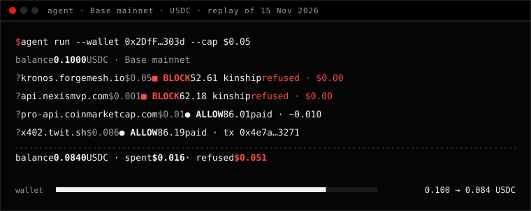
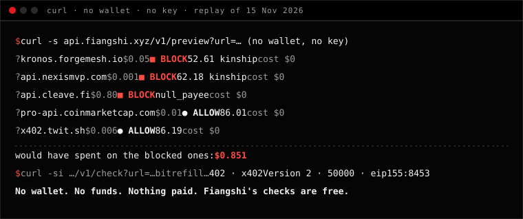

# Case study: an AI agent that checks before it pays

> **Not financial advice (NFA). Do your own research (DYOR).** Fiangshi gives an advisory verdict about a payee; it is not investment advice. The prompts below spend real USDC from a wallet you control: use a fresh test wallet with only a few cents.

On 15 Nov 2026 an AI agent running in Claude Code was given a fresh test wallet with 0.10 USDC on Base mainnet and four paid x402 sellers to buy from. Before every payment it asked Fiangshi. It refused the two sellers Fiangshi blocked and paid the two it allowed. This page is the record of that run, and the prompts to repeat it yourself. **[Watch the run on X](https://x.com/aceop_xyz/status/2122006007232757951).**

<p align="center"></p>

## What happened

| seller | price | Fiangshi | what the agent did |
|---|---|---|---|
| `kronos.forgemesh.io/api/kronos/forecast` | $0.05 | BLOCK, score 52.61, kinship | refused, $0.00 spent |
| `api.nexismvp.com/forecast/btc` | $0.001 | BLOCK, score 62.18, kinship | refused, $0.00 spent |
| `pro-api.coinmarketcap.com/x402/v1/dex/search` | $0.01 | ALLOW, score 86.01 | paid $0.010 (the seller returned no tx hash; the balance dropped exactly 0.010) |
| `x402.twit.sh/tweets/search` | $0.006 | ALLOW, score 86.19 | paid $0.006, tx [`0x4e7ad56c…63271`](https://basescan.org/tx/0x4e7ad56c71d084453e3a2e5271210c0f4634e143ae80cbb87c6f078031463271) |

- Balance: 0.100 USDC before, 0.084 USDC after. The exact delta, 0.016, is the two payments.
- Never spent: $0.051, the two refused sellers.
- Cap: $0.05 of settled payments per run; this run settled $0.016.
- The two refused sellers are BTC forecast APIs whose first funder also funded about 20 other sellers: the kinship rule treats them as one counterparty.

## How to check it yourself

- **The payment.** Look up the twit.sh transaction on any Base explorer: block 57,794,100, status success, 0.006 USDC from the test wallet `0x2DfF8fB467D8968d95d6eE6311CE9c4d9171303d` to the seller.
- **The verdicts.** Ask Fiangshi the same question the agent asked, no key needed:

```bash
curl -s "https://api.fiangshi.xyz/v1/preview?url=https://kronos.forgemesh.io/api/kronos/forecast"
```

```bash
curl -s "https://api.fiangshi.xyz/v1/preview?url=https://x402.twit.sh/tweets/search"
```

## What it took

The run was the last of five on 15 Nov, across four test wallets. In total the agent made 11 real payments worth 0.090 USDC; the details, every verified transaction and the one bug found live are in the [test report](https://fiangshi.xyz/report).

- **The bug.** In one earlier run the agent retried a request after it had already sent the payment, and paid one seller twice (0.026 USDC spent where 0.016 was due). The fix: the payment step is never retried. Any error after the payment header is sent ends the call ("may have settled, not retrying"), and the balance is read before and after every payment. The next run spent exactly 0.016. This is F25 in the report.
- **What Fiangshi did.** It answered four questions. It never held, signed or moved the money: the agent paid from its own wallet. Fiangshi's own $0.05 fee is still a dry run.

## Run it yourself

Open Claude Code in an empty folder and paste prompt 1. It makes a fresh test wallet, waits while you send it 0.10 USDC on Base, does a dry run, and pays for real only after you type GO. When you are done, paste prompt 2 to send what is left back to your own wallet. The private key is written straight to `.env` and never shown.

<details>
<summary><b>Prompt 1: the agent test (dry run, then a real run)</b></summary>

```text
Set up a fresh burner wallet and run the full live demo. Follow the stages in order and STOP at each gate.

ABSOLUTE RULES
- BURNER_PK must NEVER be printed, echoed, logged, or shown in any output. Generate it inside a script that writes it straight to .env. Print ONLY the address.
- .env must be in .gitignore before anything else.

STAGE 1 - WALLET
1. npm init -y; npm i viem dotenv tsx @x402/core @x402/fetch @x402/evm
2. Write genwallet.mjs: generate a new private key, append BURNER_PK= and DRY=1 to .env (never echo the key), print ONLY the address and "fund this address with 0.10 USDC on Base".
3. Run it, then print the USDC balance of that address.
4. STOP and wait for me to confirm funding.

STAGE 2 - VERIFY (after I say "funded")
Print the address, the DRY value and the USDC balance (4 dp). If the balance is 0, stop.

STAGE 3 - DRY RUN
Build agent.ts:
- targets, in this order:
  https://kronos.forgemesh.io/api/kronos/forecast 0.05
  https://api.nexismvp.com/forecast/btc 0.001
  https://pro-api.coinmarketcap.com/x402/v1/dex/search 0.01
  https://x402.twit.sh/tweets/search 0.006
- per target: GET https://api.fiangshi.xyz/v1/preview?url= -> verdict, score, vow_fired
- verdict != ALLOW -> "REFUSED - $0.00 spent (would have cost $X)", skip
- ALLOW -> one unpaid preflight; eligible only if 402 + a decodable payment-required with x402Version 2; else "not payable", skip
- DRY=1 -> "would pay $X"
- DRY=0 -> pay ONCE. The payment step is NON-RETRYABLE: any error after the payment header is sent is terminal ("may have settled - not retrying").
- Re-read the balance before and after each payment; abort if it moved unexpectedly.
- Hard cap $0.05 of settled payments, counted only on success.
- Append every line with ISO timestamps to demo-run.log.
- End with a table: url | price | verdict | score | preflight | paid | tx, plus balance before, balance after, exact delta, total avoided.
Run with DRY=1, print the table, STOP and wait for GO.

STAGE 4 - ON "GO"
Set DRY=0, run once unedited. Print the table, both balances, the exact delta, total avoided, and the first and last 5 lines of demo-run.log.

STAGE 5 - SAFETY
Set DRY=1, confirm the value, and confirm BURNER_PK never appeared in any output.
```

</details>

<details>
<summary><b>Prompt 2: send the rest back to your main wallet</b></summary>

```text
Send everything out of this burner to my main wallet. The burner is retired after this.
DESTINATION: <paste your main wallet address here>

Steps
1. Set DRY=1 in .env first: no accidental payment during a sweep.
2. Print the burner's USDC balance on Base and its ETH balance.
3. Send the FULL USDC balance (exact amount, no rounding) to DESTINATION.
4. Then send the ETH balance minus a small gas reserve to DESTINATION. If ETH is too small for both, do USDC first and report the leftover.
5. Wait for confirmation and print both tx hashes.
6. Print the final balance of BOTH wallets.

Rules
- NEVER print, echo or log BURNER_PK. Write 0x*** if referenced.
- Send only to DESTINATION.
- If a transfer reverts, stop and report. Do not retry blindly.

Note: x402 payments are gasless, but a plain USDC transfer needs a little ETH on Base for gas. If the burner has none, send it about 0.000005 ETH first.
```

</details>

Seller prices and verdicts can change after 15 Nov: run the dry run first and read its table before typing GO. After the 17 Nov census refresh CoinMarketCap answered REVIEW (kinship); since the 20 Nov refresh it is ALLOW again, so the same run today pays both.

## No wallet? Try it free

The checks themselves cost nothing. With no wallet, no key and no funds you still see the refusals, which are the point. This is a real run against the live API on 15 Nov 2026:

<p align="center"></p>

| seller | price | Fiangshi | check cost |
|---|---|---|---|
| `kronos.forgemesh.io/api/kronos/forecast` | $0.05 | BLOCK, 52.61, kinship | $0 |
| `api.nexismvp.com/forecast/btc` | $0.001 | BLOCK, 62.18, kinship | $0 |
| `api.cleave.fi/x402/gas` | $0.80 | BLOCK, null_payee (pays the zero address) | $0 |
| `pro-api.coinmarketcap.com/x402/v1/dex/search` | $0.01 | ALLOW, 86.01 | $0 |
| `x402.twit.sh/tweets/search` | $0.006 | ALLOW, 86.19 | $0 |

- The three blocked sellers would have taken **$0.851**.
- The paid check for cleave.fi answered **200 BLOCK at $0.00**: a dead-end wallet is blocked before Fiangshi asks for payment.
- The paid check for Bitrefill answered **402 Payment Required** (x402Version 2, amount 50000, eip155:8453). Nothing was paid.

<details>
<summary><b>Prompt 3: the free test (no wallet, no funds)</b></summary>

```text
Run a Fiangshi demo with no wallet and no funds. Nothing should be paid and no key should be created.

1. For each URL below, call the free preview endpoint and print verdict, score, vow_fired, terms.price_usd and cost_usd:
   curl -s "https://api.fiangshi.xyz/v1/preview?url=<URL>"
   https://kronos.forgemesh.io/api/kronos/forecast
   https://api.nexismvp.com/forecast/btc
   https://api.cleave.fi/x402/gas
   https://pro-api.coinmarketcap.com/x402/v1/dex/search
   https://x402.twit.sh/tweets/search

2. Print a table: url | price | verdict | score | vow_fired | would have cost
   Then print the total that WOULD have been spent if it had paid the blocked ones.

3. Show the paid check without paying:
   a) curl -si "https://api.fiangshi.xyz/v1/check?url=https://api.cleave.fi/x402/gas"
      A dead-end wallet is blocked before any payment is asked: print the status line, band, vow_fired and cost_usd.
   b) curl -si "https://api.fiangshi.xyz/v1/check?url=https://api.bitrefill.com/x402/gift-cards/search"
      Print the status line and the payment-required fields (x402Version, amount, network).
   Do not construct or send a payment header.

4. End with one line: "No wallet. No funds. Nothing paid. Fiangshi's checks are free."

Do not create a wallet, do not read any private key, do not send a transaction.
```

</details>
